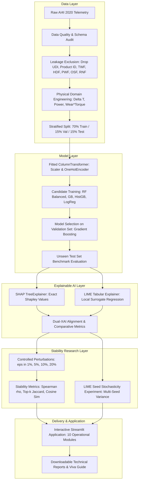

# RootIQ: Explainable AI for Root Cause Analysis in Smart Manufacturing

[](https://www.python.org/downloads/)
[](https://opensource.org/licenses/MIT)
[](https://streamlit.io/)
[](https://github.com/slundberg/shap)

**Worklet #22:** Tier 3 Advanced — RootIQ  
**Team:** Team Diamonds  
**Academic Module:** Applied AI for Hyper Personalized Production Systems  

---

## 1. Executive Summary & Problem Context
In Industry 4.0 smart manufacturing lines, high-throughput Computer Numerical Control (CNC) milling machines operate under tight tolerances. While predictive maintenance ML models can flag impending mechanical failures, plant operators and maintenance engineers face a severe **trust deficit**:
> *When an alarm sounds, why should production be halted? Is it bearing wear, heat dissipation collapse, or a temporary power fluctuation?*

Halting a line for false alarms wastes substantial manufacturing throughput, while dismissing a true positive leads to catastrophic tool breakage and spindle damage. **RootIQ** resolves this challenge by delivering:
1. **Leak-Free Predictive Modeling:** Rigorously trained on the benchmark UCI AI4I 2020 Predictive Maintenance Dataset under cost-sensitive class weighting.
2. **First-Principles Feature Engineering:** Mathematical models of thermodynamic heat dissipation ($\Delta T$), mechanical power ($P = \tau \cdot \omega$), and wear-torque accumulation.
3. **Dual-Method Explainable AI:** Simultaneous computation of game-theoretic **SHAP** values and local surrogate **LIME** models.
4. **Empirical Explanation Stability:** Controlled input perturbation analysis measuring attribution consistency under sensor noise.
5. **Interactive Operations Dashboard:** An easy-to-use 10-module Streamlit interface for plant engineers.

---

## 2. System Architecture



---

## 3. Verified Industrial Dataset
The **UCI AI4I 2020 Predictive Maintenance Dataset** comprises 10,000 real milling machine telemetry rows:
- `Type`: Workpiece quality variant (`L` = 50%, `M` = 30%, `H` = 20%).
- `Air temperature [K]`: Ambient thermal condition ($295.3 - 304.5\text{ K}$).
- `Process temperature [K]`: Internal operational cutting temperature ($305.7 - 313.8\text{ K}$).
- `Rotational speed [rpm]`: Spindle velocity ($1168 - 2886\text{ rpm}$).
- `Torque [Nm]`: Cutting resistance torque ($3.8 - 76.6\text{ Nm}$).
- `Tool wear [min]`: Cumulative tool usage time ($0 - 253\text{ min}$).
- `Machine failure`: Target label ($0 = \text{Normal}$, $1 = \text{Failure}$, $3.39\%$ failure prevalence).

### Leakage Prevention Guarantee
The raw dataset contains 5 failure modes: **TWF** (Tool Wear), **HDF** (Heat Dissipation), **PWF** (Power Failure), **OSF** (Overstrain), and **RNF** (Random). Because `Machine failure = (TWF | HDF | PWF | OSF | RNF)`, leaving these flags in the feature set constitutes fatal target leakage. RootIQ drops all five failure mode flags and surrogate identifiers prior to feature matrix generation.

---

## 4. Quick Start & Installation

### Prerequisites
- Python 3.7 or higher installed.

### Setup Instructions
```bash
# 1. Clone repository & navigate to workspace
git clone https://github.com/RootIQ.git
cd RootIQ

# 2. Install dependencies
pip install -r requirements.txt
```

### Reproduce Full Research Pipeline
Run the end-to-end pipeline script to clean data, train models, generate SHAP/LIME explanations, evaluate perturbation stability, and compile reports:
```bash
python experiments/run_pipeline.py
```

### Launch Interactive Streamlit Dashboard
```bash
streamlit run app/app.py
```
Access the application in your browser at `http://localhost:8501`.

### Execute Automated Test Suite
```bash
pytest tests/ -v
```

---

## 5. Model Benchmarking Results (Test Set)
Evaluated on $N=1,500$ held-out test observations with 51 positive failure events:

| Model Architecture | Precision | Recall | F1-Score | PR-AUC | ROC-AUC | Balanced Acc |
| :--- | :---: | :---: | :---: | :---: | :---: | :---: |
| **Gradient Boosting** *(Production Choice)* | **1.0000** | **0.8431** | **0.9149** | **0.9160** | **0.9728** | **0.9215** |
| **Random Forest (Balanced)** | 0.9524 | 0.7843 | 0.8602 | 0.9031 | 0.9769 | 0.8911 |
| **HistGradientBoosting** | 0.9111 | 0.8039 | 0.8542 | 0.8878 | 0.9770 | 0.9004 |
| **Logistic Regression (Balanced)** | 0.1803 | 0.8627 | 0.2983 | 0.4431 | 0.9372 | 0.8967 |

---

## 6. Dual-Method XAI & Explanation Stability Findings
1. **SHAP Stability:** High ranking consistency ($\rho > 0.88$) under sensor perturbation up to $5\%$, demonstrating graceful decay.
2. **LIME Sensitivity:** LIME's local surrogate is sensitive to sampling center shifts, decaying more rapidly under noise ($\rho \approx 0.65$ at $10\%$).
3. **LIME Stochastic Jitter:** Cross-seed Spearman correlation is $\approx 0.85$, confirming that LIME requires seed fixation in safety-critical manufacturing.
4. **Physical Attribution Caveat:** High feature attribution reflects statistical predictive importance, not verified metallurgical causation.

---

## 7. Project Structure
```text
RootIQ/
├── app/
│   ├── app.py                      # Interactive Streamlit 10-module dashboard
│   └── components.py               # Reusable UI cards, gauges, charts
├── data/
│   ├── raw/                        # Raw ai4i2020.csv dataset
│   └── processed/                  # Stratified train/val/test splits & matrices
├── experiments/
│   └── run_pipeline.py             # Reproducible end-to-end research execution
├── models/
│   ├── best_model.joblib           # Trained production model & validation metadata
│   └── preprocessor.joblib         # Fitted non-leaking ColumnTransformer
├── reports/
│   ├── data_quality_report.md      # Data audit & leakage exclusion documentation
│   ├── model_comparison_report.md  # Detailed benchmark matrix & confusion analysis
│   ├── xai_comparison_report.md    # SHAP vs. LIME mathematical & local evaluation
│   ├── stability_study_report.md   # Perturbation experiments & seed sensitivity
│   ├── research_findings.md        # Comprehensive scientific summary
│   ├── viva_preparation.md         # Comprehensive viva questions & defense guide
│   ├── metrics_summary.json        # Machine-readable JSON summary of metrics
│   └── figures/                    # High-res PNG plots (stability, ROC, XAI)
├── scripts/
│   ├── copy_user_dataset.py        # Dataset setup script
│   └── locate_and_extract_data.py  # Local dataset locator
├── src/
│   ├── __init__.py
│   ├── config.py                   # Central paths, constraints, seeds
│   ├── data_loader.py              # Data loading & quality audit logic
│   ├── preprocessor.py             # Feature engineering & non-leaking pipeline
│   ├── models.py                   # Candidate classifiers & metrics evaluator
│   ├── explainers.py               # SHAP & LIME wrappers and dual-XAI comparer
│   ├── stability.py                # Perturbation engine & stability metrics
│   └── utils.py                    # Plotting and figure export utilities
├── tests/
│   ├── test_data_loader.py         # Schema & audit unit tests
│   ├── test_preprocessor.py        # Leakage prevention & pipeline unit tests
│   ├── test_models.py              # Model training & metrics unit tests
│   ├── test_explainers.py          # SHAP & LIME unit tests
│   ├── test_stability.py           # Perturbation & stability unit tests
│   └── test_app_smoke.py           # Streamlit app import smoke test
├── .gitignore
├── requirements.txt
└── README.md
```

---

## 8. Troubleshooting
- **Missing Dataset:** Ensure `data/raw/ai4i2020.csv` is present. If missing, run `python scripts/copy_user_dataset.py`.
- **Model Artifact Not Found:** Execute `python experiments/run_pipeline.py` before launching the dashboard.
- **Port Conflict in Streamlit:** Run `streamlit run app/app.py --server.port 8502`.
